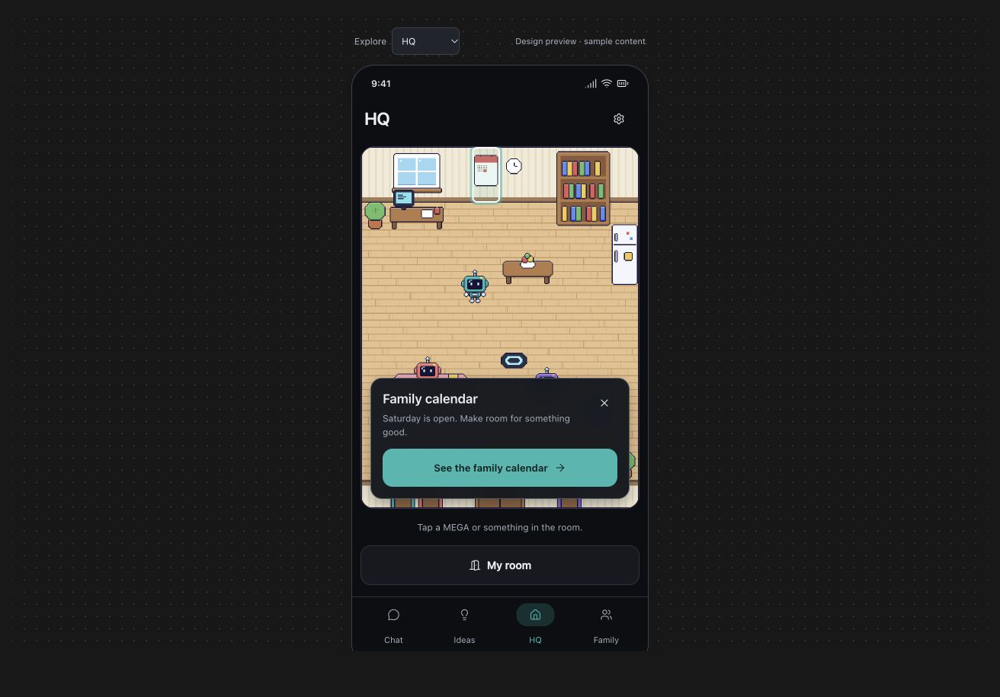

> Current demo workflow: [Settings → Demo Console](../demo-console.md). The three-person live Gmail scenario and age-group policy in that guide supersede historical demo, seeded-reset, and sample-sign-in instructions below.

# MEGA UI/UX research and design direction

This delivery is a screen-by-screen source audit and an interactive concept for the main flows. It does not change the production interface. The [complete audit](2026-10-30-screen-audit.md) records every route, unfinished behavior, role boundary, and verification case. The earlier performance fixes remain in place.

The user confirmed that **Ideas should collect all useful MEGA suggestions, with gifts as one category**. The navigation, layouts, and implementation sequence below are recommendations for that goal.

## What stays

MEGA remains a family assistant with pixel characters and a shared room. Keep its existing Midnight and Light themes, teal/custom accents, type and spacing scales, large child controls, native navigation, and privacy choices. Keep characters prominent when meeting or customizing them, and give conversation, forms, and tasks the space they need elsewhere.

The prototype uses the Midnight theme and illustrative content. Its actions demonstrate layout and navigation locally; they do not send messages, change accounts, or save household data. It is not a substitute for native-device acceptance testing.

## Five changes to the main experience

| Problem | Proposed change | Evidence and limits |
| --- | --- | --- |
| Chat replies and the input compete with character art and separate controls. | Keep a small character in the header. Let assistant content use the available thread width. Put a multiline text region and an internal action row inside one full-width composer; Voice and Send occupy one stable trailing position. | The user requested this. [Google](https://mobbin.com/screens/34ec4cfb-0a70-4c73-b333-94abed3a98cd) and [Perplexity](https://mobbin.com/screens/0b64c112-f8cc-48d2-abd4-31cbd0f27e94) show text and attachment/action controls within one composer boundary. These are precedents for the composer structure; removing repeated MEGA avatars follows the user's complaint and the app's width constraints. |
| The profile combines a large passive character with privacy, appearance, history, and app settings. | Use a compact identity row with Customize, followed by grouped Memories, Privacy & sharing, and permitted Activity/Rules destinations. Keep global Settings directly accessible. Give appearance editing its own preview and visual category controls. | [Apple Music](https://mobbin.com/screens/dfdc460a-a358-42e2-9e70-26cd9c41f292) shows a compact identity row above grouped account actions. [Kit](https://mobbin.com/screens/879e9e07-222e-44e1-998f-03a542e2ee63) and [Meta Quest](https://mobbin.com/screens/fa003442-780b-44a8-bae9-973695ee93c1) separate character preview from customization categories. These support hierarchy and editor structure, not a change to MEGA's character style. |
| Selecting something in HQ puts its feedback below the room. | Keep the room within the available height. Open one short contextual panel inside the main viewport, with the selected object visible, a clear action, and Close. Expand only when more detail is needed. | [Zesty](https://mobbin.com/screens/0f62379d-7e46-4b31-a33e-142417b0c018) and [Pangea](https://mobbin.com/screens/35d864c0-77f9-492e-8ffb-595593434807) show a selected place and its details together. The borrowed structure is spatial selection plus an in-view panel; MEGA keeps its room and objects. |
| Useful suggestions disappear into Chat; Settings and Lists require hunting. | Propose adult tabs **Chat · Ideas · HQ · Family**, plus a consistent Settings gear. Ideas has search, categories, source, audience, and supported actions. Family exposes Calendar, Lists, Places, and members. | [Insight Timer](https://mobbin.com/screens/3364d0a3-4938-400a-9b75-947c21f55580) groups saved content into named destinations; [Savee](https://mobbin.com/screens/8fbd1638-c71d-4262-b334-6bb131cf8f18) exposes saved collections and search. They support rediscovering saved material. The fourth tab and the category names are our recommendation for the user's stated scope. |
| Welcome spends space on one large motionless MEGA despite having a walker system. | Remove the static hero. Stage three small characters around the wordmark and button ledges, with brief greetings, encounters, and reactions to presses. Keep the auth controls stable and pause motion while a form is open. | This direction comes from the user's explicit request and the existing scripts, ledges, tap reactions, and reduced-motion support. The [Finch setup flow](https://mobbin.com/flows/ab3823c2-2068-4b25-965a-c4a2f9290102) was reviewed, but its static captures do not establish how characters move or interact. We do not use those images as animation evidence. |

The common direction is to keep actions beside the content they concern. The references supply structure. MEGA supplies the colors, characters, language, and family permissions.

## Platform guidance checked

- Apple's [tab bar guidance](https://developer.apple.com/design/human-interface-guidelines/tab-bars) describes tabs as top-level destinations, recommends clear labels and avoiding overflow, and distinguishes navigation from actions. This supports keeping Settings as a utility and treating Ideas as a destination if it becomes a frequent task. It does not prescribe these four particular tabs.
- Apple's [sheet guidance](https://developer.apple.com/design/human-interface-guidelines/sheets) supports scoped tasks, nonmodal supplementary controls on iOS, progressive expansion, and clear dismissal. For HQ, the initial panel should retain the room context; an editor can open a separate focused sheet. Avoid a stack of sheets that obscures the route back.
- Apple's [motion guidance](https://developer.apple.com/design/human-interface-guidelines/motion) calls for purposeful, optional motion and brief feedback. Welcome can carry the character interactions requested by the user; controls must remain usable immediately and without animation.

These pages were read on October 30, 2026 UTC. They are design guidance, not measured outcomes for MEGA.

## Ideas needs a complete product path

Ideas should retain useful suggestions, including ones the user has not yet explicitly saved. It should not indiscriminately duplicate every chat message or treat every learned memory as an idea.

Proposed behavior:

1. MEGA emits a structured suggestion when a response contains a useful candidate. Index it with its source message, short title, category, reason, creator, and original audience. A user can also explicitly save a suitable suggestion from Chat.
2. The library distinguishes **Suggested**, **Saved**, and completed/dismissed state. Category filters such as Activities, Meals, Home, and Gifts work across these states; the initial view can combine useful suggestions without making saving mandatory.
3. Each idea shows enough source context and visibility to judge it. Discuss returns to Chat with that idea's context. Add to list or calendar is offered only when there is a real backed operation, with an editable preview and success/error state.
4. Shared ideas require a deliberate sharing action. Viewing a family member's conversation does not grant permission to save or publish on their behalf. Gift ideas retain their recipient exclusions through search, detail, counts, linked lists, notifications, and derived actions.
5. Use paginated queries and deduplicate by a stable source identifier. Avoid loading all past messages into a client-side Ideas array. Search and category changes must not accumulate subscriptions or background work.

The app currently has birthday gift suggestions and generic lists, but no general Ideas route or entity. Existing gift-to-list copying loses the gift recipient restriction when it becomes a plain adults-scope list. Fix that before aggregating gifts in Ideas. See the audit's [Ideas and privacy sections](2026-10-30-screen-audit.md#ideas-product-and-backend-work-required).

Children retain their current tabs during the first implementation. A child Ideas experience needs explicit categories, actions, ownership, and parental visibility rules. This is a proposed rollout boundary, not a claim that existing direct links already enforce every intended restriction.

## Motion and performance contract

- Keep at most the existing three welcome walkers; coordinate encounters through one scene controller rather than adding an independent timer per interaction.
- Suspend scene work when unfocused, backgrounded, hidden by a form, or reduced motion is enabled. Keep tap feedback and all controls available in the still state.
- Animate transforms and opacity without rebuilding chat or form state each frame. Preserve the optimized sprite paths and stable movement schedules from the memory audit.
- Keep celebrations finite. Preserve virtualized conversations, bounded caches, timer cleanup, recording cleanup, and HQ's settled idle state.
- Compare idle memory and render activity against the recorded Chat/HQ baseline after implementation. A visually richer preview is not evidence of acceptable native performance.

## Implementation sequence

| Wave | Work | Completion criteria |
| --- | --- | --- |
| 1: Main-screen layout | Chat replies/composer/streaming row; compact profile; shared Settings access; HQ context panel; welcome composition and scene suspension. | The user's stated spacing and selection problems are resolved; all existing controls retain their backed behavior; keyboard, large text, roles, and reduced motion work. |
| 2: Ideas | Audience-safe suggestion contract, ingestion/deduplication, pagination, library and detail, Chat save/discuss actions, adult navigation. | Useful suggestions can be found again; actions persist; gift restrictions survive every derived view and action. This can proceed alongside Wave 1 without delaying its layout fixes. |
| 3: Family organization | Actionable Today, Calendar event details, list creation and reliable edits, member flows, visible room placement. | Visible controls finish the task their labels promise; empty and failed states provide recovery. |
| 4: Remaining screens | Talk transcript/review/accessibility; homework photo review; routine completion; onboarding forms/recovery; accounts feedback; widget platform instructions; customization/store density. | Every route passes its state matrix in the audit, with no placeholder or silent failure presented as completed behavior. |

## Evidence status

All route patterns and major embedded surfaces were inspected in source. The running web app was also inspected for Chat, MEGA profile, HQ, Family, and Calendar. The HQ selection panel appeared below the visible room area; tapping a Calendar event opened its location editor; Family exposed Places and Calendar but no Lists or Ideas shortcut. Browser viewport overrides did not change the reported viewport, so these observations are desktop web checks, not phone measurements. Source-based phone-width calculations are labeled as such in the audit.

The prototype demonstrates the proposed main-screen relationships with sample content. It does not implement backend Ideas, account changes, native keyboards, production auth, or a completed room editor. The audit separates those product gaps from visual changes so a screen does not appear finished before its actions work.

Prototype checks completed: Chat's local send flow; Ideas save and Saved filtering; HQ object selection and dismissal; profile and welcome at a 320px container; sign-in sheet fit and dismissal. The 320px HQ panel's measured bounds stayed within the room. The source was checked for network calls (none), embedded-asset validity, JavaScript syntax, hidden-scene suspension, and reduced-motion handling. The app's lint and type checks pass. Native keyboard, VoiceOver, all production roles, and native performance remain implementation acceptance checks.

The screenshot below is the proposed HQ interface, not a screenshot of a production change:

